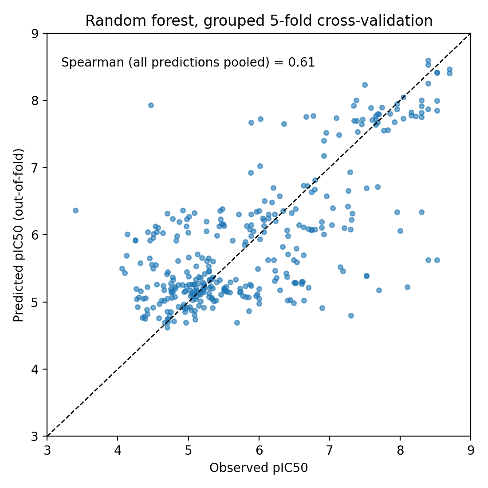
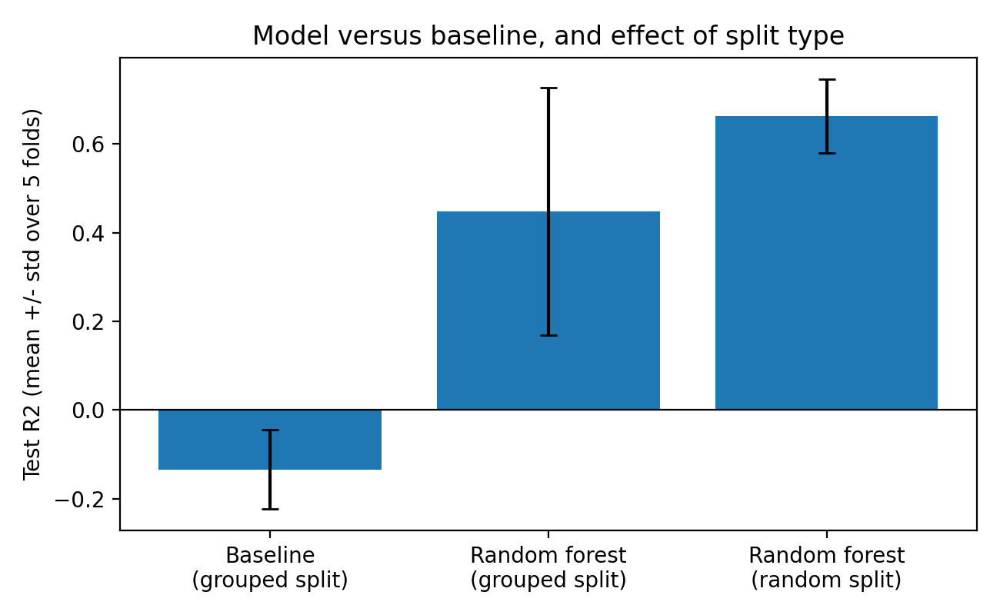
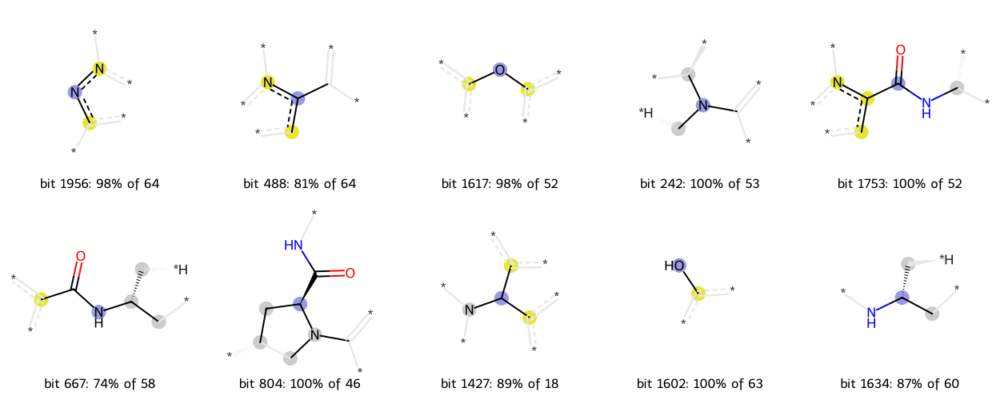

# Predicting InhA inhibitor potency from ChEMBL data

A small machine-learning project on public bioactivity data for **InhA**, the enoyl-ACP reductase of *Mycobacterium tuberculosis* (ChEMBL target CHEMBL1849). A random forest predicts pIC50 (-log10 of the IC50 in molar units) from molecular structure. The emphasis is on **how honest the evaluation is**: data cleaning, leakage checks, a baseline, a label-shuffling control and error analysis.

> **Summary.** A random forest on Morgan fingerprints predicts pIC50 clearly better than a mean-value baseline, but the result is moderate: test R² = 0.45 ± 0.28 when molecules from the same chemical series are kept out of training, versus 0.66 when the split is random. The model is better at telling *which kind* of molecule is potent than at ordering close analogues within one series. This is a computational prediction on public enzyme-assay data, not experimental validation.

## Research question

Can a model trained on known InhA IC50 measurements predict the enzyme potency of molecules from chemical series it has not seen, and how much better is it than a trivial baseline?

## Biological background

Tuberculosis is caused by *M. tuberculosis*. InhA is a key enzyme of the bacterial fatty acid elongation pathway (FAS-II) that builds mycolic acids, the long lipids of the mycobacterial cell wall. InhA is the primary target of the frontline drug isoniazid: isoniazid is a prodrug that must first be activated by the enzyme KatG, and its activated form inhibits InhA. Because this activation step is a route to drug resistance, compounds that inhibit InhA directly are of interest. Several chemical classes of direct InhA inhibitors have been reported, for example alkyl diphenyl ethers and pyrrolidine carboxamides (references below).

pIC50 = 9 - log10(IC50 in nM). Higher pIC50 means a more potent inhibitor; a tenfold change in IC50 is one pIC50 unit.

## Dataset

- **Source:** ChEMBL web interface, target CHEMBL1849 (InhA, *M. tuberculosis*). ChEMBL release: **37** (the web interface reported 1,970,438 assays, the published ChEMBL 37 count). Downloaded **06-10-2026**. The raw zip is kept unmodified in `data/raw/`.
- Raw file: 1,460 records, 48 columns, 488 IC50 records. Only enzyme IC50 records are used; whole-cell (MIC) and percent-inhibition records are not.

| Step | Records / molecules |
|---|---|
| IC50 records with relation "=" | 403 records, 346 molecules |
| Keep units nM (one record in µg/mL dropped) | 402 records, 345 molecules |
| Remove records ChEMBL flagged "Outside typical range" | 23 records removed (20 from assay CHEMBL3047415, 2 from CHEMBL4380941, 1 from CHEMBL5623729); 342 molecules |
| Merge a salt duplicate (CHEMBL539344 into CHEMBL216689) | **341 molecules** |

- **pIC50 is computed per record first, then the median is taken per molecule.** An earlier version took the median of raw nM values; a molecule with records of 130 nM and 7.7 million nM got an average of 3.85 million nM.
- 23 molecules have more than one record; the records of 5 of them differ by more than one pIC50 unit and none by more than two.
- The duplicate pair differs by 0.35 pIC50 units (6.854 and 7.208); it was merged by averaging (7.031).
- Final pIC50 range is about 3.4 to 8.7. There are 144 Bemis-Murcko scaffolds; 98 of them occur only once in the 342-molecule table, and 99 in the final 341-molecule table.
- **Removing flagged records is a mechanical rule, not a judgement on each value.** It removes the weakest records: the flagged IC50 values range from 122,180 nM to about 91 million nM. The three flagged records from the two smaller assays (127,000, 280,000 and 291,000 nM) are weak but plausible values, and one unflagged record from the suspicious assay (CHEMBL264679, 87,096 nM) remains in the data.

## Pipeline

```
raw ChEMBL zip -> filter (IC50, "=", nM) -> drop flagged records -> pIC50 per record
-> median per molecule -> merge salt duplicate -> Bemis-Murcko scaffolds
-> Morgan fingerprints -> grouped 5-fold split (scaffold + identical fingerprint)
-> baseline and random forest -> metrics, shuffled-label control
-> error analysis, fingerprint-bit analysis -> figures
```

## Method

- **Features:** Morgan fingerprints, radius 2, 2048 bits, binary (RDKit).
- **Models:** scikit-learn `RandomForestRegressor` with default settings (`random_state=42`, not tuned) and `DummyRegressor` (training mean) as baseline.
- **Validation:** 5-fold `GroupKFold`. Groups are Bemis-Murcko scaffolds merged with groups of identical fingerprints (144 scaffold groups merge into 140). A scaffold-only split still had 6 test molecules with an identical-fingerprint partner in training; after merging there are 0. For comparison, a shuffled 5-fold `KFold` is also reported.
- **Metrics:** RMSE, R² and Spearman correlation, as mean ± standard deviation over folds.
- The first version of this analysis used a scaffold-only split and gave R² 0.52 ± 0.19 and RMSE 0.77 ± 0.12; the drop to 0.45 after fixing the leak is within fold-to-fold noise and should not be read as an exact effect.

## Results

Test-set results, mean ± standard deviation over 5 folds (341 molecules).

| | Baseline (predicts training mean) | Random forest, **grouped** split | Random forest, random split |
|---|---|---|---|
| RMSE (pIC50 units) | 1.203 ± 0.058 | **0.819 ± 0.207** | 0.678 ± 0.084 |
| R² | −0.134 ± 0.089 | **0.448 ± 0.278** | 0.663 ± 0.083 |
| Spearman | not defined | **0.629 ± 0.160** | 0.773 ± 0.045 |
| Mean max. Tanimoto similarity, test to training | n/a | 0.582 | 0.730 |

- **Grouped split** = test molecules never share a Bemis-Murcko scaffold, or an identical fingerprint, with any training molecule. This is the headline result.
- **Random split** is shown only for comparison. It is more optimistic (R² 0.66 vs 0.45) because test molecules have close relatives in training (similarity 0.73 vs 0.58).
- Training R² is about 0.96 for the forest, so it memorises its training data; only test numbers are meaningful.
- With 5 folds of about 68 molecules, the fold-to-fold spread is large (R² std 0.28), so the size of the gap between the two splits is uncertain.




### Control: shuffled labels
Training labels were shuffled among training molecules (10 seeds, grouped folds), test labels kept real. Result: test R² = −0.367 ± 0.094 and Spearman = −0.047 ± 0.085. Scores collapse to chance, so the real model's performance is not an artefact of the pipeline. (R² below zero is expected for a model fitted to noise.)

### Other findings
1. **Within-series ranking is uneven.** For the 8 scaffold groups with at least 10 molecules, the Spearman correlation between observed and predicted pIC50 is high for two (0.75, 0.74), moderate for three (0.30, 0.32, 0.41) and near zero for three (0.14, 0.04, 0.07). Potency varies little within a series (standard deviation 0.37 to 0.89, versus about 1.2 for all molecules), which makes ranking hard. Each series has only 10 to 26 molecules, so these values are noisy.
2. **Largest errors.** The ten largest out-of-fold errors are 2.0 to 3.5 pIC50 units. Four molecules have a very similar training neighbour (Tanimoto 0.73 to 0.81) with a very different measured potency; this is consistent with activity cliffs or assay noise, and I could not separate the two without the source papers. Six molecules have no similar training molecule (Tanimoto 0.13 to 0.44) and received mid-range predictions, i.e. chemistry outside the model's experience. Five of the ten appear, from their structures, to belong to one series (a 1,3,4-thiadiazole linked to an N-benzylpyrazole) whose observed potencies range from 4.5 to 8.5.
3. **Fingerprint collisions.** 12 molecules share an identical Morgan fingerprint with another molecule (5 groups). Two groups are stereoisomer pairs (potency difference 0.12 and 0.44). Three groups are different structures, for example cyclohexyl, cycloheptyl and cyclooctyl variants, with potency differences up to 1.14 pIC50 units but identical predictions. Binary radius-2 Morgan fingerprints cannot separate these.
4. **Important fingerprint bits.** Seven of the ten most important bits (1956, 488, 1617, 242, 1753, 667, 804) appear in the top 20 in at least 4 of 5 folds; the other three (1427, 1602, 1634) are unstable and are not interpreted. Each of the ten stands mostly for one chemical environment (74% to 100% of the molecules carrying it; the rest are hash collisions). Six of the seven stable bits are present in 46 to 64 molecules each, and the mean pIC50 is about 2 units higher for molecules with the bit than without (for example aromatic N-N ring atoms and a carboxamide next to a ring nitrogen). The diaryl-ether bit (1617, 52 molecules) shows a smaller difference (6.45 vs 5.79). The strong bits overlap heavily: all 52 molecules with bit 1753 also carry bits 1956, 488 and 667, and all 46 molecules with bit 804 also carry bit 242. Bit 1956 alone occurs in 64 molecules spanning 36 different scaffolds. Together the six strong bits cover 80 molecules (mean pIC50 7.25, 45 scaffolds) against 5.47 for the other 261, so they mostly describe one overlapping group of potent molecules rather than six independent features. This is an association in 341 molecules, not evidence of mechanism, and importance is shared among correlated bits.



## Biological interpretation

- Diaryl ethers are a known class of direct InhA inhibitors (Tonge et al. 2007; Sullivan et al. 2006). That a diaryl-ether fingerprint bit is associated with higher pIC50 is therefore consistent with the literature. It is not a new finding.
- Ring-size variants (cyclohexyl, cycloheptyl, cyclooctyl) of one pyrrolidine carboxamide have pIC50 7.03, 6.57 and 5.89 in this data. He et al. (2006) report for the pyrrolidine carboxamide series that cyclohexyl and cycloheptyl are the best and comparable, with a slight decrease for cyclooctyl, which has the same direction. These records come from ChEMBL document CHEMBL1137386 (J Med Chem, 2006); I have not confirmed that this is the same paper, so the comparison is a hypothesis.
- The same paper reports that only one enantiomer of these compounds inhibits InhA, so a fingerprint that cannot distinguish stereoisomers has a real blind spot for this series.
- For the series with the strongest bits (a pyrazole-carboxamide series with a benzofuran amide) I did not review the literature, so I make no biological claim about them.
- Enzyme potency is not cell activity: in He et al. (2006) most of the enzyme-potent compounds had whole-cell MIC values above 125 µM.

## Limitations

- Only 341 molecules, one target and one model type; the forest was not tuned.
- No external test set: all evaluation is cross-validation inside one ChEMBL release. A time-based or newer-release test was not done.
- Data are enzyme assays from many labs; pIC50 values from different assays and conditions are combined, which limits achievable accuracy. ChEMBL contains published, often optimised, series, so it is not a random sample of chemical space.
- A few chemical series dominate the data, so the model may mostly learn those series. Even the grouped split is not fully independent (mean similarity of test molecules to training: 0.58).
- One fixed grouping into 5 folds was used; repeated grouped cross-validation would give a better estimate of the spread. No prediction uncertainty is provided.
- Results show that the model estimates enzyme potency for held-out molecules from this literature set better than guessing. They do not show that it finds new active chemistry or predicts activity in living bacteria.
- Binary Morgan fingerprints cannot distinguish stereoisomers or some ring-size variants.
- Removing ChEMBL-flagged records is a mechanical rule that removes the weakest records.

## Future work

- Repeated grouped cross-validation and nested tuning of the forest; compare with count fingerprints, chirality-aware fingerprints, physicochemical descriptors and a similarity-based nearest-neighbour baseline.
- Test on a later ChEMBL release, or on a time-based split.
- Extend from one target to several targets (a drug-target interaction setting), with the same grouped validation.
- Add prediction uncertainty. Any use on new compounds (for example docking hits) would be hypothesis generation only, clearly labelled as prediction.

## Tools and versions

Python 3.13 (Google Colab), RDKit 2026.03.6, scikit-learn 1.6.1, pandas 2.2.3, NumPy 2.1.3, SciPy 1.16.3, Matplotlib 3.10.0 (see `requirements.txt`).

## Reproducing this analysis

```
inha-activity-prediction/
  data/raw/         original ChEMBL download (zip, unmodified)
  data/processed/   cleaned molecule tables
  notebooks/        01_data_cleaning.ipynb, 02_modelling_and_controls.ipynb
  results/          metrics, out-of-fold predictions, saved outputs
  figures/          plots
```

1. Install the packages in `requirements.txt`.
2. The notebooks were run in Google Colab with all files in one working folder. Put the raw zip in the same folder as the notebooks, then run `01_data_cleaning.ipynb` followed by `02_modelling_and_controls.ipynb`, each from top to bottom. Files are written to the working folder; the copies in `data/processed/`, `results/` and `figures/` are the outputs of these runs.
3. Random seeds are fixed, so folds and results should reproduce to within rounding (a different scikit-learn version can change the last digit).

## References

- He X, Alian A, Stroud R, Ortiz de Montellano PR. Pyrrolidine carboxamides as a novel class of inhibitors of enoyl acyl carrier protein reductase (InhA) from *Mycobacterium tuberculosis*. J Med Chem 2006; 49(21): 6308-6323.
- Tonge PJ, Kisker C, Slayden RA. Development of modern InhA inhibitors to combat drug-resistant strains of *Mycobacterium tuberculosis*. Curr Top Med Chem 2007; 7(5): 489-498.
- Sullivan TJ, Truglio JJ, Boyne ME, Novichenok P, Zhang X, Stratton CF, Li HJ, Kaur T, Amin A, Johnson F, Slayden RA, Kisker C, Tonge PJ. High affinity InhA inhibitors with activity against drug-resistant strains of *Mycobacterium tuberculosis*. ACS Chem Biol 2006; 1(1): 43-53.
- ChEMBL: Zdrazil B, Felix E, Hunter F, et al. The ChEMBL Database in 2023: a drug discovery platform spanning multiple bioactivity data types and time periods. Nucleic Acids Res 2024; 52(D1): D1180-D1192 (the ChEMBL website lists the currently recommended citation).

## Data licence

The data come from ChEMBL, distributed under a Creative Commons Attribution-ShareAlike licence; check the current terms on the ChEMBL website before redistributing the data.

## Author

Kanneganti Meenakshi Naga Prasanna, GitHub: kannegantimeenakshi5-max.